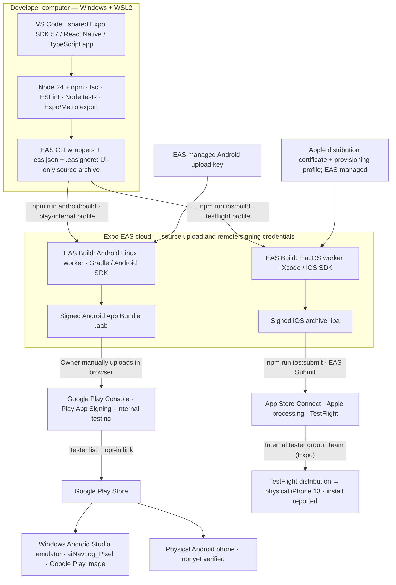

# Mobile build and deployment — physical architecture

This view shows the actual tools and services used to build and distribute the
current Android and iOS UI/demo. It complements the [boat/instrument physical
architecture](orion-physical-architecture.md); build infrastructure is separate
from runtime instrument communication and local boating data.




## Tool responsibilities

| Stage | Shared tools | Android path | iOS path |
| --- | --- | --- | --- |
| Edit and configure | VS Code, Windows/WSL2, Expo SDK 57, React Native, TypeScript, Expo Router | `expo.android.package` | `expo.ios.bundleIdentifier` |
| Local checks | Node 24/npm, TypeScript, ESLint, Node tests, Expo CLI/Metro export | Android JS export | iOS JS/Hermes export |
| Scope cloud upload | `.easignore`, UI-root EAS wrapper, `EAS_PROJECT_ROOT`, `EAS_NO_VCS` | `scripts/eas-android.mjs` | `scripts/eas-ios.mjs` |
| Native cloud build | EAS CLI → Expo EAS Build | Android/Linux worker, Gradle and Android SDK | macOS worker, Xcode and iOS SDK; no local Mac required |
| Signing | Credentials managed remotely by EAS | Upload keystore signs AAB; Google Play App Signing signs distributed APKs | Apple distribution certificate and provisioning profile |
| Artifact | Local download and identity/checksum verification | `.aab` for Play; optional `.apk` profile for direct install | `.ipa` for App Store Connect/TestFlight |
| Upload | Explicit operations; no scheduled builds or uploads | Manual AAB upload in Google Play Console | EAS Submit uploads the verified IPA to App Store Connect |
| Beta distribution | Account/tester setup is distinct from build success | Internal testing tester list and opt-in link | Apple processing, internal group and eligible testers, TestFlight app |
| Installation validation | Launch, navigation, demo and lifecycle checks | Android Studio emulator on Windows; physical Android separately | Physical iPhone 13 installation reported; local iOS Simulator requires macOS/Xcode |

Both platforms use `com.kodekomplete.com.ainavlog`. Their store records, signing
credentials and version/build counters are separate. iOS App Store Connect ID:
`6823786033`; Expo project ID: `6b2c9577-6a5b-4380-a200-d5221085458c`.

The Android emulator is installed on Windows and uses WHPX acceleration and an
Android 16/API 36 Google Play image. WSL2 hosts the source/build commands, not the
Android emulator's hardware acceleration. It cannot emulate iOS.

## Current evidence — October 16, 2026

- Android: corrected AAB 1.0.0 / version code 1 accepted by Google Play internal
  testing. Owner confirmed emulator installation and supplied Home launch evidence.
  Electrical/navigation/lifecycle checks and physical Android install remain open.
- iOS: signed IPA 1.0.0 / build 1 downloaded and inspected. Owner's App Store
  Connect screenshot showed **Processing**. The owner subsequently confirmed installation on a
  physical **iPhone 13**. Owner then confirmed Electrical, navigation and close/reopen checks passed.
  Installed version and iOS version remain unreported; installation source was
  not independently inspected.
- Apple membership is active, per owner confirmation. The local iOS configuration
  and compiled app declare `ITSAppUsesNonExemptEncryption=false`.

The current binaries contain the UI shell and visibly labeled Electrical demo.
Rust decoding, mobile Bluetooth scanning/bridge and phone-local SQLite are not
packaged in these releases. The Linux-tested Rust/C bridge and desktop monitor
remain a separate development path. Cloud build/store services do not implement
or host aiNavLog boating-data storage. An accepted build is not proof of physical
instrument reception or persistence.

## Repeatable commands

From `aiNavLog/user-interface/`:

```sh
npm run typecheck
npm run lint
npm test

# Android: inspect → build → manually upload AAB in Play Console.
npm run android:archive -- --force
npm run android:build

# iOS: inspect → build → submit the verified downloaded artifact.
npm run ios:archive -- --force
npm run ios:build
npm run ios:submit -- --path builds/ainavlog-ios-1.0.0-1.ipa
```

Do not resubmit an artifact already processing. Before future builds, verify
package identity, intended signing team/key and available version code/build
number, then increment the relevant counter. TestFlight submission is separate
from public App Store release. Android's current path is manual Play upload;
iOS uses EAS Submit, not manual Transporter upload.

See [Android deployment](android-manual-deployment.md),
[emulator setup](android-emulator.md), [iOS TestFlight](ios-testflight.md),
[iOS build evidence](ios-first-build-2026-10-16.md), and
[latest status](status/status-2026-10-16.md).

Sources: [EAS Build](https://docs.expo.dev/build/setup/),
[EAS configuration](https://docs.expo.dev/eas/json/),
[TestFlight through EAS](https://docs.expo.dev/submit/testflight/),
[Google internal testing](https://support.google.com/googleplay/android-developer/answer/9845334).
