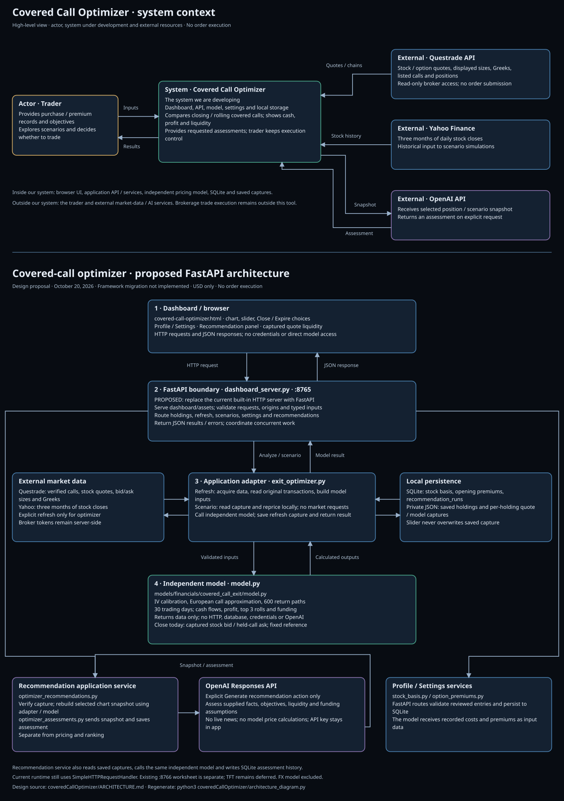
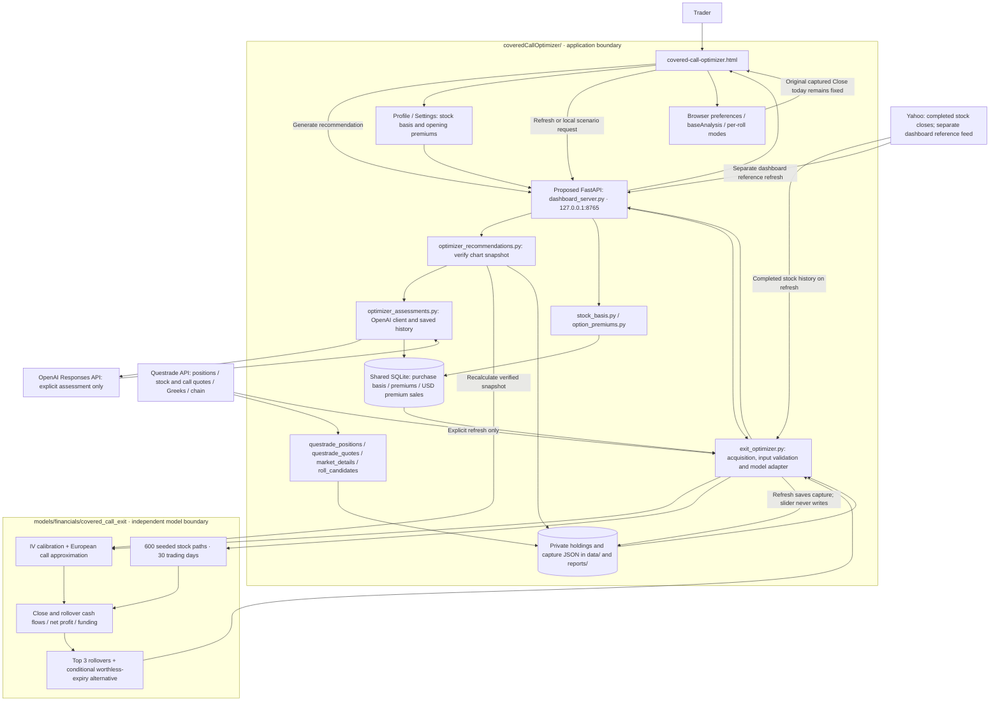
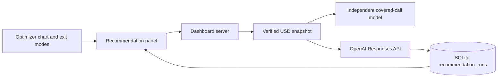

# Covered-call optimizer architecture · proposed FastAPI boundary

Updated October 20, 2026. This view covers the local portfolio application and
USD covered-call optimizer. The separate CIBC FX model and its training,
evaluation and publishing workflows are excluded from this architecture view.
**Design proposal only:** the diagram shows the intended FastAPI boundary. The
running `dashboard_server.py` still uses Python’s built-in HTTP server; no
application code or runtime behavior is changed by this architecture update.

Main flow: **Dashboard → FastAPI (`dashboard_server.py`) → application adapter
(`exit_optimizer.py`) → independent model (`model.py`)**. Results return through
the adapter and API to the dashboard. Market access, persistence and OpenAI stay
in the application; the model receives data and returns calculations.



## High-level system context

The first panel of the architecture diagram shows the **trader** as the actor,
**Covered Call Optimizer** as the system we are developing, and **Questrade API**,
**Yahoo Finance** and **OpenAI API** as external resources. The trader supplies
transaction records, objectives and scenario choices, then reviews results.
Questrade supplies broker market/position data; Yahoo supplies historical stock
closes; OpenAI receives a selected snapshot and returns an explicitly requested
assessment. Trade execution remains outside the system.

The dashboard, API, application services, independent pricing model, SQLite and
saved captures are inside the system boundary. The lower panel expands those
internal components and labels the FastAPI migration as proposed.

## Responsibility boundaries

| Boundary | Owns |
| --- | --- |
| Browser | Profile / Settings, optimizer chart, slider, Close/Expire controls and fixed quote reference |
| `coveredCallOptimizer/` | Proposed FastAPI service, broker authentication, source data, validation, application adapters, persistence and existing optional OpenAI assessment workflow |
| `models/financials/covered_call_exit/` | Independent option valuation, stock-return simulation, cash-flow calculations, rollover funding and ranking; no credentials, network calls or app server |
| External services | Questrade market/position data, Yahoo market references/history, and OpenAI assessments only on explicit generation through the optimizer panel or separate worksheet |



## Browser and application surfaces

### Optimizer home page and Profile / Settings

`covered-call-optimizer.html` is the active home page, served directly from source.
`/`, `/index.html` and the former `/equity-chart.html` URL redirect to it.
The optimizer's My profile menu opens its settings dialog on the same page.
`optimizer_profile.js` adapts the shared settings scripts; `/api/profile/holdings`
uses `portfolio_data.py` for saved-position data without importing archived UI code.

The former equity dashboard, renderer and dashboard-only JavaScript are preserved
under `archive/equity-dashboard/`. Its private report is optionally viewable at
`/archive/equity-chart.html`. Shared settings, accounting, broker helpers and
financial data stay active. Position imports do not regenerate the archive unless
`--archive-chart` is explicitly requested.

Profile / Settings owns stock cost basis and original option sale capture. The
USD-only form records an exact opening sale without requiring CAD conversion.
The existing converted-premium form is an optional settings section. Neither
form places an order. Verified records are shared with the optimizer through
SQLite. Duplicate opening confirmations are checked across both premium formats.
Multiple matching opening lots are not silently chosen or aggregated.

`profile_ui.js`, `profile_settings.js` and `option_premiums_ui.js` implement these
settings. Minimum bids, profile preferences and some entry overrides remain in
browser storage; authoritative purchase records are in SQLite.

### USD covered-call optimizer

The chart is the primary interface. It shows four groups: fixed captured Close
today first, followed by the top three ranked rollover candidates. Each rollover
has Close/Expire radio buttons, defaulting to Close. The stock-price slider
updates hypothetical rollovers while keeping Close today fixed at actual captured
stock bid / held-call ask. The original quote midpoint remains marked on the slider.

The independent model receives dictionaries from `exit_optimizer.py`. It returns
cash-flow components, simulated ranges, sale-floor path frequencies, assignment
strike checks, top choices, conditional expiry outcomes and rollover funding.
The browser presents these values rather than retrieving broker credentials or
sending orders. Per-roll mode switches are local chart updates, not broker requests.

## Model behavior represented by this architecture

- Replacement strike is **at least 1.20× original USD stock purchase price and
  strictly above stock midpoint**, with no fixed upper cap. Slider scenarios use
  their hypothetical midpoint for the out-of-the-money test.
- Search listed future expirations from tomorrow through one year after the held
  call's expiry. Same-day expiration is excluded.
- Use three months of completed daily stock history and 600 repeatable bootstrap
  paths. Close-mode review/liquidation is after 30 trading days.
- Calibrate each option's IV from captured quotes. Use a European call approximation,
  constant IV, captured absolute spreads and an assumed 4% discount rate.
- Rank the top three by Close-mode estimated net profit, including losses. The
  original purchase ×1.10 stock-sale floor is reported, not used to hide results.
- **Close profit:** discounted closing cash + original gross premium − original
  gross stock cost. Both stock and option position are liquidated.
- **Expire:** conditional worthless expiry without assignment; retain stock and
  report option-only P&L = original premium + replacement premium − held-call
  buyback today. Future replacement buyback is zero; stock gain/loss is excluded.
- **Roll cash needed:** max(held-call buyback today − replacement premium, 0).
  Same entry requirement in Close and Expire; excludes fees, available account
  cash, collateral, broker margin and additional-deposit calculations.

All optimizer outputs are USD, fees excluded. The user has accepted the constant
volatility/spread assumptions for current use; that is not predictive validation.
Retained-stock option P&L is not interchangeable with fully liquidated position
profit. See the [optimizer guide](COVERED_CALL_OPTIMIZER_README.md).

## Refresh, scenario and local-mode sequence

```mermaid
sequenceDiagram
    actor Trader
    participant UI as Optimizer browser
    participant App as dashboard_server / exit_optimizer
    participant Local as SQLite + holdings / capture JSON
    participant Market as Questrade + Yahoo
    participant Model as Independent covered_call_exit model
    Trader->>UI: Refresh data & analyze
    UI->>App: POST /api/exit-optimizer/run
    App->>Local: Read original basis, premium and held contract
    App->>Market: Fetch and validate history / current quotes / chain
    App->>Model: evaluate(inputs)
    Model-->>App: Cash flows, top 3, ranges, funding, Expire alternatives
    App->>Local: Save private input/result capture
    App-->>UI: Render chart; store baseAnalysis
    Trader->>UI: Move stock-price slider
    UI->>App: POST /api/exit-optimizer/scenario
    App->>Local: Read original capture
    App->>Model: Copy inputs, reprice quotes at fixed IV / spreads, evaluate
    Note over App,Model: No broker calls; no saved-capture writes
    Model-->>App: Hypothetical rollover results
    App-->>UI: Redraw; original Close today group remains fixed
    Trader->>UI: Select Close / Expire on one rollover
    UI->>UI: Use precomputed alternative; retain fixed reference
    Note over Trader,UI: Expire assumes worthless expiry and retained stock; it is not an order
```

## Proposed FastAPI migration boundary

`dashboard_server.py` will become the HTTP entry point with typed request schemas,
origin checks, response/error handling, static page/assets, and routes to the
existing app services. `exit_optimizer.py` remains the acquisition and model
adapter; the API should not absorb broker or pricing logic. Model results return
through the adapter and FastAPI to the dashboard. Endpoint ownership below
remains the target contract; the framework migration has not started.

Recommendations remain an application service: validate the selected capture,
rebuild the model snapshot and send it to OpenAI. They do not move into `model.py`.
The same separation applies to settings and SQLite writes.

## API ownership

| Endpoint on port 8765 | Responsibility |
| --- | --- |
| `GET /api/profile/holdings` | Shared saved-position data for the optimizer profile dialog |
| `GET /api/exit-optimizer/holdings` | Saved covered-call holdings available for selection |
| `POST /api/exit-optimizer/run` | Explicit market refresh, model evaluation and saved capture |
| `POST /api/exit-optimizer/scenario` | Local saved-snapshot stock-price scenario; no market refresh or persistence |
| `GET/POST /api/stock-cost-basis` | Authoritative original purchase records |
| `GET/POST /api/option-premiums/usd` | USD-only opening-call confirmations |
| `GET/POST /api/option-premiums` | Existing converted opening-call confirmations |
| `POST /api/roll-candidates/refresh` | Existing dashboard replacement-call scanner |
| `POST /api/optimizer-recommendations` | Rebuild selected chart snapshot, request an OpenAI assessment and save it |
| `GET /api/optimizer-recommendations/status` | Safe configuration status without credentials |
| `GET /api/optimizer-recommendations/history` | Saved optimizer assessments and input snapshots |
| `GET /api/macro` | Separate dashboard market-reference feed; not optimizer price prediction |

Mutation routes validate their dashboard origin and request sizes. Model refresh
and scenario calls share serialization with the broker refresh workflow. Token
rotation and authentication stay in the app; refresh failures retain the previous
saved market capture. A page reload alone does not refresh broker quotes.

## Persistence and provenance

| Store | Purpose |
| --- | --- |
| `coveredCallOptimizer/data/fx-samples.sqlite3` | Existing shared file name; purchase/premium tables used by this view are listed below |
| `stock_cost_basis` | Account/symbol/currency, quantity, recorded USD purchase price, cost and optional transaction details |
| `option_premiums` | Existing confirmed opening sales with contract identity and conversion details |
| `option_premium_sales_usd` | USD-only reviewed opening sales; created lazily on first save |
| `recommendation_runs` | Optimizer and separate worksheet assessments with immutable request snapshots, distinguished by prompt version |
| `coveredCallOptimizer/data/*.json` | Private saved account holdings and supporting inputs |
| `coveredCallOptimizer/reports/exit-optimizer-*.json` | Captured market inputs, source time and model result per holding |
| Other `reports/` files | Generated dashboards, quotes, diagrams and documentation previews |
| Browser memory / local storage | Slider state, fixed baseAnalysis, per-roll modes, profile preferences and cached overrides |

The optimizer never treats stored original premium as fresh cash available to fund
a roll. Quotes and hypothetical prices remain distinguishable. Some displayed
figures are gross cash flows; the source timestamp matters for executable prices.

## Existing separate assessment service

`close_simulator_server.py` on port 8766 and `close_recommendations.py` belong to
the investment app, not the independent optimizer model. The separate worksheet
can explicitly request a fresh OpenAI assessment and store the assessment plus its
input snapshot in `recommendation_runs`. The API key stays server-side. This
workflow's valuation dependencies are outside this USD architecture view.

The optimizer’s Recommendation panel now explicitly calls OpenAI using a verified
chart snapshot. This app service does not depend on chat history or research news;
the independent model does not use an LLM for pricing or top-three ranking.
See the optimizer recommendation path below. The separate worksheet remains
available; [assessment interactions](docs/recommendation-interactions.md) describes
that older workflow.

## Accepted scope and proposed extensions

Current scope is deterministic accounting plus conditional scenario analysis.
Historical option backtesting, a market-health/macroeconomic exit policy,
available-cash eligibility, broader objective-based ranking and common-wealth
comparison of retained/liquidated stock remain proposed work.

TFT option pricing is deferred. `design1.svg` describes a potential future
architecture, not the active runtime. New pricing models require relevant data
and evidence of improvement before promotion. The independent model/app boundary
allows such replacements without moving authentication into model packages.

See [product direction](docs/optimizer-product-direction.md), [current model
design](../models/financials/covered_call_exit/DESIGN.md) and [proposed TFT
design](../models/financials/covered_call_exit/design1.md).

## Run and regenerate the view

From the repository root:

```sh
python3 coveredCallOptimizer/dashboard_server.py
python3 coveredCallOptimizer/architecture_diagram.py
```

Home: http://localhost:8765/covered-call-optimizer.html. The former dashboard is
archived at `coveredCallOptimizer/archive/equity-dashboard/equity-chart.html`. Architecture preview:
http://localhost:8765/investment-architecture.svg.

The server binds to loopback. Private financial records, tokens and generated
reports remain local and ignored by Git. No order execution is performed.

### Optimizer recommendation path

The optimizer’s Recommendation button calls `POST /api/optimizer-recommendations` on the dashboard server. `optimizer_recommendations.py` verifies the selected holding and quote-capture timestamp, recalculates the slider scenario with the independent covered-call model, preserves the captured close-today baseline, and applies the chart’s exit modes. `optimizer_assessments.py` sends that snapshot to the configured OpenAI model and saves successful responses plus inputs in SQLite `recommendation_runs` (`optimizer-assessment-v1`). Status and history are served by `/api/optimizer-recommendations/status` and `/api/optimizer-recommendations/history`. The model remains independent of OpenAI and currency conversion.


