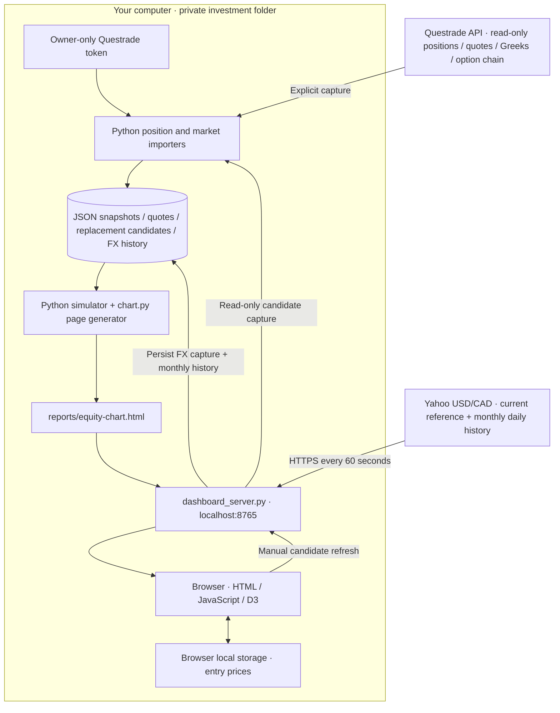

# Physical architecture of the covered-call simulator

The dashboard, position data and calculations run on your computer. Questrade
supplies read-only stock/option quotes, Greeks, listed calls and LIRA positions.
Yahoo supplies USD/CAD and one month of daily FX observations. The previous
forecast exit model is retired and archived; no stock model runs in this workflow.

Technology images use [Devicon](https://github.com/devicons/devicon), with its
[license preserved locally](docs/technology-icons/LICENSE). Questrade and Yahoo
badges are labeled service symbols.

| Location | Active technology and responsibility |
| --- | --- |
| Questrade | LIRA sync and market data; exact option deliverables verified; no order submission |
| Yahoo | USD/CAD reference and past-month daily observations |
| Local Python | Position/quote import, rollover candidate capture, current-value arithmetic and HTML generation |
| Local JSON files | Saved positions, quotes, candidate lists and macro history |
| Local server | Loopback HTTP; cached `/api/macro`; origin-checked `POST /api/roll-candidates/refresh`; serial broker refreshes |
| Browser | Account/stock filters, entry-price editor, loss thresholds, rollover recommendations, payoff curves and monthly FX chart |
| Browser local storage | Entry prices per account, contract and quantity; profile name and minimum bid per account/stock; source snapshots remain intact |

Start with `python3 dashboard_server.py` from `investment/`. Yahoo FX refreshes
immediately and every 60 seconds while the server runs. Successful captures are
saved atomically; failed requests preserve the last successful quote and history.
Broker positions and option candidates refresh only when explicitly requested.
Credentials remain server-side and are never included in the generated page.

Account defaults are **LIRA USD**, **RRSP CAD** and **TFSA CAD**. Selecting LIRA
hides the FX macro panel. Selecting a CAD account shows the FX chart and an
editable CAD-per-USD assumption, initially seeded from the saved Yahoo reference.
CAD-equivalent market quotes use this assumption; actual listed strikes and broker
Greeks keep their source units. The rollover payoff engine operates in USD with
explicit conversion for CAD cost bases. Entry-price edits update its calculations.

Saved covered-call holdings have separate Questrade market captures.
The selected account/stock refresh sends the effective USD purchase price to
the local importer; unsupported selections are rejected before authentication.
For each rollover expiry, the next listed strike at or above purchase + USD 5 is
used. The owner can search further expiry dates and set a minimum worthwhile
credit. Captured quote sizes, delays, halts and age are checked. The UI exposes
cash debit/credit, lost upside, expiry payoffs and the 5% loss rule. These are
conditional scenarios, not stock forecasts. No cloud hosting or trade execution
is used. See [rollover tools](ROLLOVER.md) and [Questrade setup](QUESTRADE.md).
