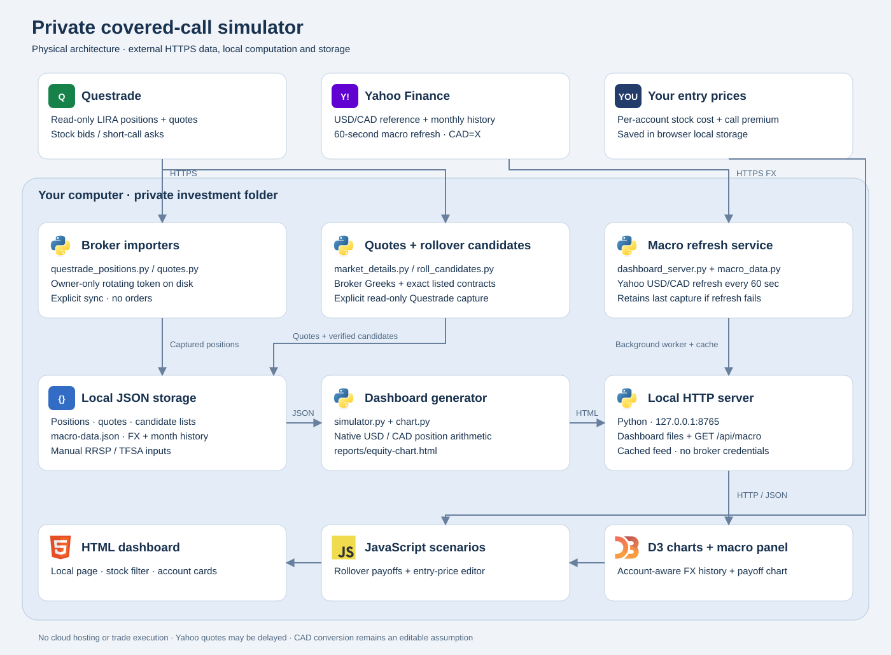
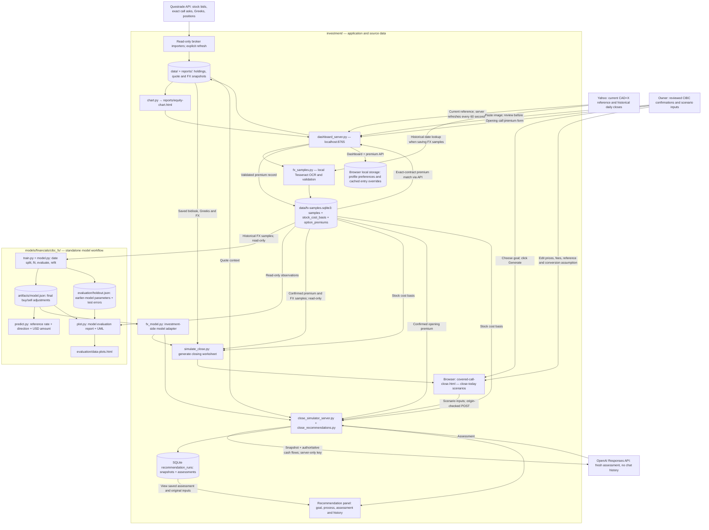

# Covered-call application and FX model architecture

The application and financial models run locally in sibling repository folders:
`investment/` owns portfolio data, broker imports and the dashboard;
`models/financials/cibc_fx/` owns independent FX training, evaluation and prediction.
The close-today simulator, OpenAI client, credentials and history belong to `investment/`. No orders are submitted by these components.





| Component / location | Responsibility |
| --- | --- |
| Questrade API and local importers | Read-only market/position capture. Stock bids, exact held-call asks, delta, theta and implied volatility are saved snapshots, not a streaming feed. Credentials stay server-side. |
| Yahoo Finance | Current CAD-per-USD reference and daily history. Current reference is an input, not a model prediction. Historical settlement-day closes are saved alongside FX samples. |
| `data/fx-samples.sqlite3` | `samples` holds reviewed FX observations; `option_premiums` holds opening call confirmations including exact contract, fees, net USD, FX and net CAD. These tables serve different purposes. |
| `stock_cost_basis` in SQLite | Shared stock basis keyed by account/ticker/currency. Stores quantity, total cost and optional purchase date, USD price, fees and historical FX. Average cost is total divided by quantity. Dashboard, closing generator and OpenAI assessments read this source. |
| Dashboard browser storage | Profile and thresholds, cached entry-price overrides, and a legacy basis backup for optional import. SQLite basis takes precedence. Exact-match database premiums populate entry overrides. |
| `train.py` / `model.py` | Read SQLite without modification; validate rows; split by settlement dates; fit median proportional adjustments separately for buying and selling USD; score later rows; refit final model on all eligible rows. |
| `artifacts/model.json` | Final prediction parameters, training timestamp, date and amount ranges, sample counts and dataset hash. |
| `evaluation/holdout.json` | Test errors and the earlier-data parameters used for those errors. These are distinct from the final all-data model. |
| `predict.py` | Standalone estimate from user-supplied reference, direction and USD amount. No automatic quote retrieval. |
| `investment/simulate_close.py` | Generates a private, standalone HTML worksheet from saved quotes, SQLite purchase basis, confirmed premiums and the final model. Browser JavaScript applies the saved model adjustments when scenario inputs change. |
| `plot.py` | Generates model charts and UML using saved observations, final adjustments and holdout parameters. |

## Closing simulation: inputs versus predictions

The closing worksheet is currently a full-position ASTS example, separate from
the main dashboard. It uses Questrade quotes and Greeks, Yahoo reference FX,
the confirmed stock purchase basis, and the database opening premium. The source
and capture times are displayed. Editing bid, ask or reference creates a manual
scenario override; saved Greeks do not recalculate with edited prices.

For each direction, the predicted rate is:

`reference CAD per USD × (1 + fitted directional adjustment)`

The current assumption is **separate conversion of each closing leg**:

- Stock sale: `(shares × stock bid − stock fees) × predicted sell-USD rate`.
- Call buyback: `(contracts × 100 × call ask + call fees) × predicted buy-USD rate`.
- Net closing cash: converted stock proceeds minus converted call cost.
- Total position gain: original net call premium minus stock basis plus net closing cash.

The original premium is historical cash already received, not additional closing
cash. Conversion treatment is an assumption, not a confirmed CIBC settlement rule.
A selectable net-USD alternative remains available for comparison. The worksheet
assumes closing today; it does not retrieve future or historical scenario prices.

The dashboard's existing rollover and stock-risk calculations still use its
editable FX assumption. They do not automatically use the standalone FX model.
Profile settings saves cost basis through `/api/stock-cost-basis`. The closing
server regenerates the worksheet from SQLite on page load; Refresh quotes also
loads the current saved basis. OpenAI assessments read SQLite directly. A backup
of previous browser bases can be explicitly imported in Profile settings.

## How the recommendation is created

The recommendation is now a fresh OpenAI assessment, requested explicitly from
the panel. There is no chat-session dependency and no fixed rule-based fallback.
The trained FX model remains separate from the language model.

1. Select a goal and optionally refresh broker quotes and Yahoo FX first.
2. The browser sends scenario inputs to `POST /api/recommendations` on `investment/close_simulator_server.py`.
3. `investment/close_recommendations.py` validates inputs, reads confirmed basis/premium and fitted
   parameters, and recalculates cash flows in Python. Browser totals are ignored.
4. The server sends the snapshot, calculations, selected goal and versioned
   assessment instructions to the OpenAI Responses API. The key stays in the
   server environment or ignored private configuration; it is never in HTML.
5. Successful text, model, timestamp, prompt version, API usage and immutable input
   snapshot are saved in SQLite `recommendation_runs`.
6. The browser displays the assessment, process steps and expandable input record.
   History shows original saved assessments; edits mark the current result stale.

The API request uses `store=false`, but transaction amounts and quote context are
sent to OpenAI. API usage is billed to the configured OpenAI project. No key is
preconfigured. Run `investment/setup_openai.py` to enter a key through hidden terminal input.
Opening the panel or viewing history does not call OpenAI. There are no research
tools in the request: the assessment cannot claim current news, full portfolio
knowledge or replacement-investment analysis. Greek data may provide context but
is not a forecast. Missing configuration and API failures are shown explicitly;
the application never executes trades.

## Execution, refresh and persistence

From the repository root:

```sh
# Main dashboard; Yahoo reference refreshes in the background.
cd investment
python3 dashboard_server.py
```

Model commands, from the repository root:

```sh
python3 models/financials/cibc_fx/train.py
python3 models/financials/cibc_fx/plot.py
python3 investment/simulate_close.py
python3 investment/close_simulator_server.py
```

Training and HTML generation are explicit operations, not background jobs. The
standalone report server serves files and accepts an origin-checked, serialized
`POST /api/quotes/refresh`. The Refresh quotes button explicitly fetches Questrade
quotes and Yahoo FX, then replaces the browser quote inputs and Greeks. Failed
refreshes retain the prior scenario. Page reload alone does not request new quotes.
The refresh does not retrain the model.
SQLite, private JSON inputs, model artifacts and generated evaluation pages are
local and excluded from Git. Source code and documentation are versionable.

## Model limits

Settlement-day Yahoo closing rates are retrospective. Fitted adjustments mix
broker pricing and reference-timing differences; they are not isolated fees.
Holdout evaluation keeps a settlement date entirely on one side of the split,
but transactions sharing dates are correlated. Live-reference prediction accuracy
is unvalidated. Neither the FX model nor the closing worksheet forecasts stock
prices, call prices or future FX. Fees, available quote size and actual fills can
change closing proceeds.

See [model documentation](../models/financials/cibc_fx/README.md),
[model UML](../models/financials/cibc_fx/INTERACTIONS.md),
[recommendation UML](docs/recommendation-interactions.md),
[rollover tools](ROLLOVER.md), and [Questrade setup](QUESTRADE.md).

See the [actual SQLite ERD](docs/database-erd.md) for fields, unique keys and snapshot storage.
