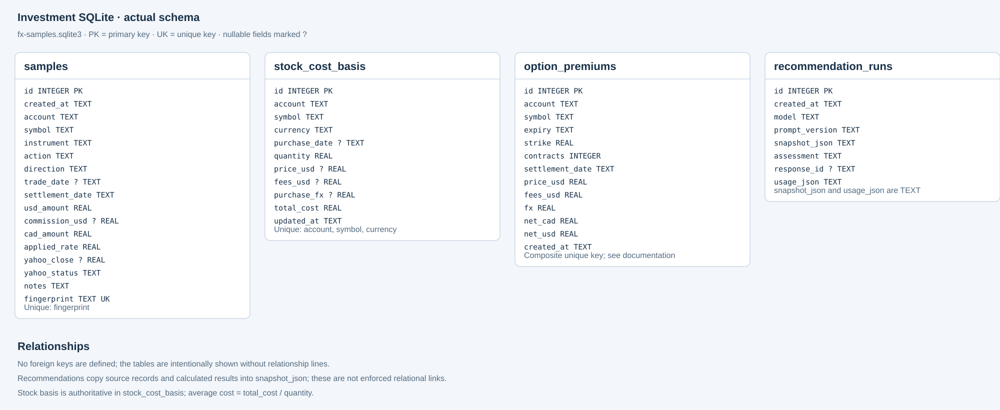
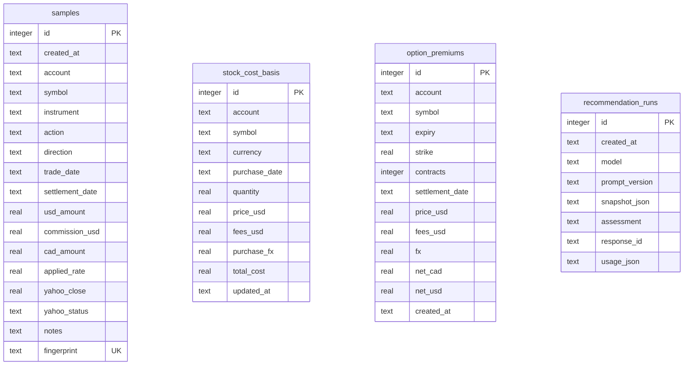

# Investment database ERD

Database: `investment/data/fx-samples.sqlite3`.
This diagram is generated from the actual schema. No foreign keys currently exist.

- `samples`: reviewed FX observations used to train the CIBC FX model.
  `fingerprint` is unique. `trade_date`, `commission_usd` and `yahoo_close` may be null.
- `stock_cost_basis`: shared stock basis, uniquely keyed by `(account, symbol, currency)`.
  Average cost is computed as `total_cost / quantity`. Optional purchase detail fields
  preserve date, USD price, fees and historical FX.
- `option_premiums`: opening call confirmations. The composite unique key is
  `(account, symbol, expiry, strike, contracts, settlement_date)`.
- `recommendation_runs`: saved OpenAI assessments and immutable input snapshots.
  `snapshot_json` contains copies of source data, the scenario and calculations;
  it is not a foreign-key reference. `usage_json` contains API token usage.
  `response_id` may be null.

The shared account/ticker/date values do not enforce relationships between tables.
An opening-premium confirmation may also have an FX observation in `samples`;
these are separate records with no linking foreign key. Stock basis and quantity are authoritative in `stock_cost_basis`; browser-only
legacy values can be explicitly imported through Profile settings.

Regenerate: `python3 investment/schema_diagram.py`. This reads the database
without modifying it and writes the documentation and browser SVG copies.
