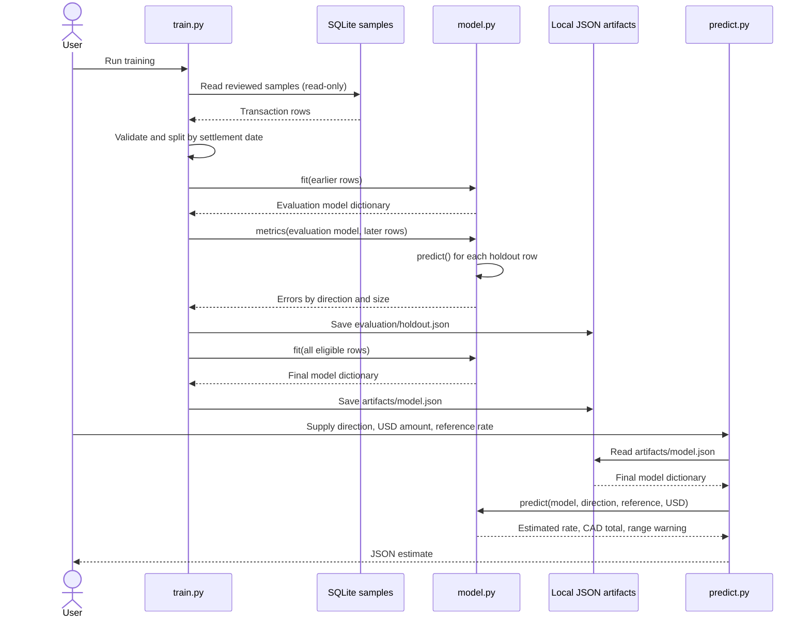

# Model interactions

The implementation uses Python modules, functions and dictionaries rather than
classes. These UML participants represent the actual components and data objects.

The **evaluation model** only sees earlier transactions. Its errors are measured
on later transactions. The **final model** is then refitted on all eligible data
and used by the prediction command. Keeping these separate prevents test results
from being calculated with a model that already saw the test transactions.

`plot.py` reads the same database, final model and evaluation report to produce
`evaluation/data-plots.html`. It uses the saved evaluation parameters for holdout
predictions and the final model parameters for the adjustment lines in chart 2.
No component writes model predictions back into the transaction database.

