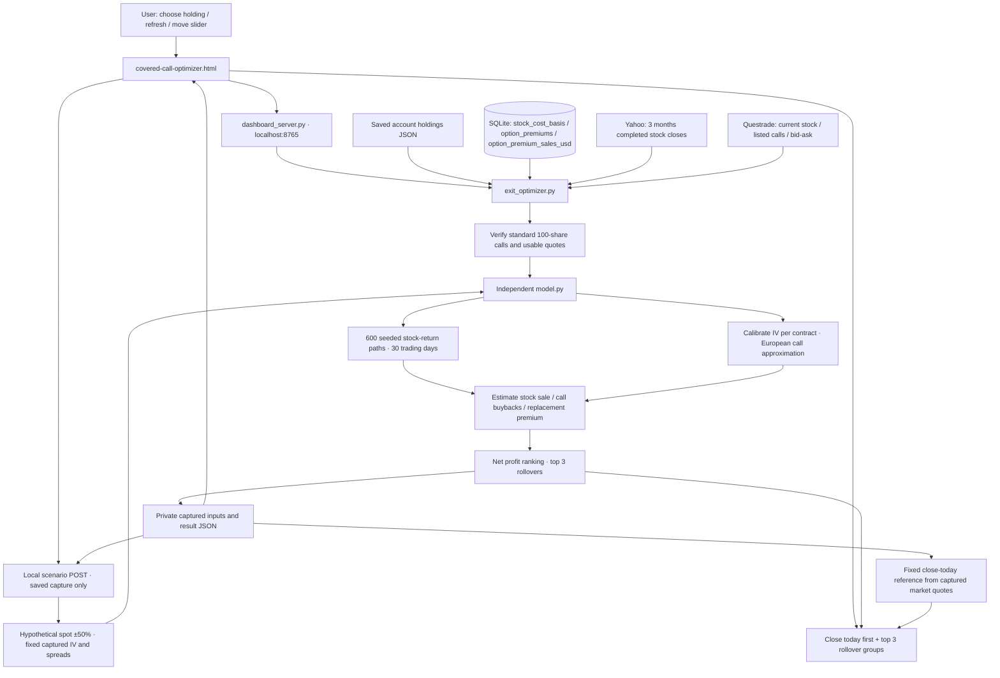
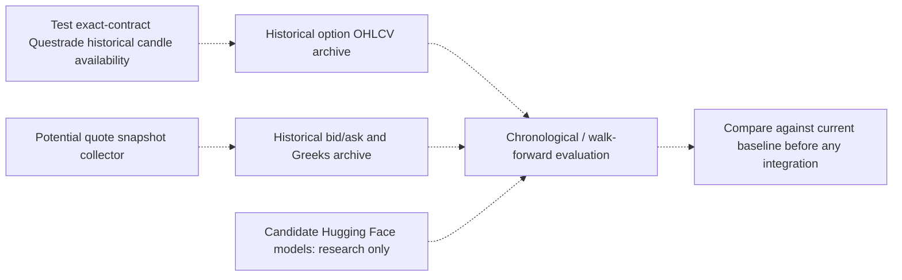

# Covered-call exit model design

[Open the design diagram](DESIGN.svg).

The implementation uses functions and dictionaries, not trained neural-network
objects. The model remains independent under `models/financials/covered_call_exit`;
all credentials, market requests, storage and UI belong to `coveredCallOptimizer`.



## Refresh and scenario sequence

```mermaid
sequenceDiagram
    actor User
    participant UI as Browser
    participant App as Investment server / adapter
    participant Sources as Yahoo / Questrade / local records
    participant Model as Independent pricing and simulation model
    participant File as Private capture JSON
    User->>UI: Refresh data & analyze
    UI->>App: POST /api/exit-optimizer/run (account, symbol)
    App->>Sources: Read holdings, original USD stock price and opening premium
    App->>Sources: Fetch daily stock history and current verified chain quotes
    App->>Model: evaluate(inputs), fixed 30 trading days
    Model-->>App: Benchmark, all scenarios, top 3, floor flags, cash-flow breakdown
    App->>File: Save captured inputs + results
    App-->>UI: Chart data
    UI->>UI: Keep baseAnalysis and current-midpoint marker
    User->>UI: Change stock-price slider
    UI->>App: POST /api/exit-optimizer/scenario (account, symbol, stock_price)
    App->>File: Read original saved capture
    App->>Model: stock_price_scenario(copy, price), then evaluate()
    Note over App,Model: No quote fetch or file write; fixed IV, spreads and random seed
    Model-->>App: Repriced rollover results and new top 3
    App-->>UI: Hypothetical result
    UI->>UI: Redraw rollovers; keep original Close today group fixed
```

## Inputs, constraints and calculations

- Replacement strikes: at least **1.20 × original USD stock purchase price** and strictly above the **stock midpoint**, with no fixed upper cap. Slider scenarios use their hypothetical midpoint for this filter.
- Expiry window: earliest listed future expiration (tomorrow or later) through 12 calendar months after the **held call's expiry**; unexpired,
  listed, verified standard calls only. Original held call is not a rollover.
- Completed stock history: previous three calendar months, at least 40 daily
  closes. Bootstrap independent historical daily log returns with replacement.
- Calibrate each option's implied volatility to its captured midpoint. Future
  buybacks use theoretical value plus captured half-spread. Volatility and
  absolute spreads remain fixed. Default risk-free rate: 4%.
- Close today: stock bid proceeds minus original call ask buyback, at captured
  quotes. This displayed reference remains fixed during slider changes.
- Roll: buy back held call and sell replacement now, then sell stock / buy back
  replacement after 30 trading days. Expiration settlement is handled if earlier.
- Closing wealth is discounted to today. Gross opening amounts are constant:
  **net profit = closing wealth + original call premium − original stock cost**.
- Select the top **three** rollovers by net profit even if negative or below the
  sale-price constraint. The 110%-of-purchase sale floor is **flagged**, not used
  to hide candidates. Fewer than three usable listed quotes is possible.
- All figures are USD, fees excluded. No CIBC FX model or OpenAI is called here.
- Browser chart: green stock sale, red buybacks, purple profit; blue replacement
  premium stacked above stock sale. Original stock cost is a solid reference line;
  original option premium is dashed. Closing cash labels align across the top.

## Planned investigation — not implemented



Questrade historical option candles have not been fetched or integrated. Historical
candles are not the same as historical bid/ask snapshots. No Hugging Face pricing
model is downloaded or used. These remain investigation steps.

## Limits

This is scenario analysis, not an empirically validated 30-day option forecast.
European pricing approximates American calls; dividends, early assignment,
changing volatility/liquidity, corporate actions, taxes and fees are omitted.
A finite-path sale-floor check cannot guarantee future execution prices. The
application records transactions and reads market data; it places no orders.
